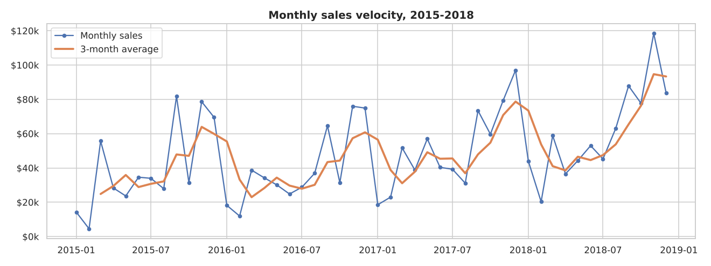
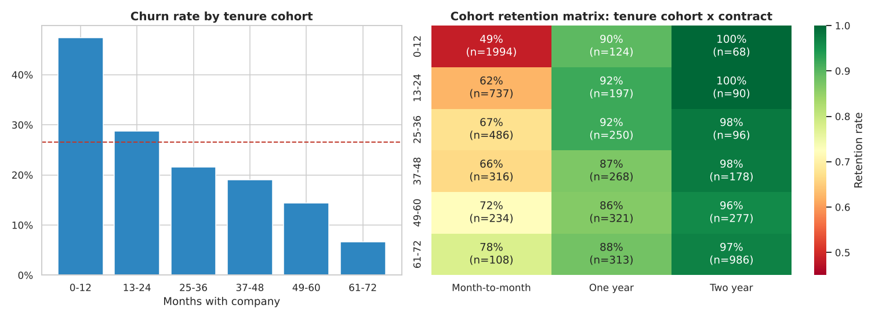

# Datheon Data Analytics & Power BI Internship

Project submission for the **Datheon Data Analytics & Power BI Internship**. Two analytics tasks were completed in Python (pandas, Matplotlib, Seaborn) on real-world business datasets.

## Tasks completed

| Task | Topic | Deliverable | Folder |
|---|---|---|---|
| Task 1 | Exploratory Data Analysis on Superstore Retail Sales | Jupyter notebook with data cleaning and 6 annotated business findings | [`Task1_Superstore_EDA`](Task1_Superstore_EDA) |
| Task 3 | Customer Cohort & Churn Analytics (IBM Telco) | Cohort retention matrix, retention curves, churn analysis and retention recommendations | [`Task3_Telco_Churn_Analytics`](Task3_Telco_Churn_Analytics) |

## Repository structure

```
.
├── README.md
├── Task1_Superstore_EDA/
│   ├── superstore_eda.ipynb
│   ├── README.md
│   ├── requirements.txt
│   ├── data/superstore_sales.csv
│   └── images/
└── Task3_Telco_Churn_Analytics/
    ├── telco_churn_analysis.ipynb
    ├── README.md
    ├── requirements.txt
    ├── data/telco_customer_churn.csv
    └── images/
```

## Task 1: Superstore Retail Sales EDA



- Found two extra tables (People and Returns) appended to the CSV; split them out instead of treating them as missing data.
- Discounts above 20% are loss-making; lines discounted over 20% lose about $135k combined.
- Furniture is 32% of sales but only 6% of profit. Tables and Bookcases lose money.
- September, November and December produce about 43% of annual sales.
- The Central region has a 7.9% margin vs 14.9% in the West, alongside much heavier discounting.

## Task 3: Customer Cohort & Churn Analytics



- Baseline churn is 26.5% (1,869 of 7,043 customers), costing about 30.5% of monthly revenue.
- Month-to-month customers churn at 42.7%, versus 2.8% on two-year contracts.
- 55.5% of churners left within their first 12 months.
- Month-to-month, fiber optic customers without tech support are 25.5% of customers but 55.3% of all churners.
- Six strategic retention recommendations are in the notebook.

## How to run

Each task is self-contained. Open a terminal in the task folder, install the requirements and start Jupyter:

```bash
cd Task1_Superstore_EDA        # or Task3_Telco_Churn_Analytics
pip install -r requirements.txt
jupyter notebook
```

## Tech

Python, pandas, NumPy, Matplotlib, Seaborn, Jupyter Notebook

## Notes

- The notebooks are saved with their outputs, so the charts and tables display directly on GitHub.
- Findings describe associations in the data and are not proven causes. Limitations are listed at the end of each notebook.
