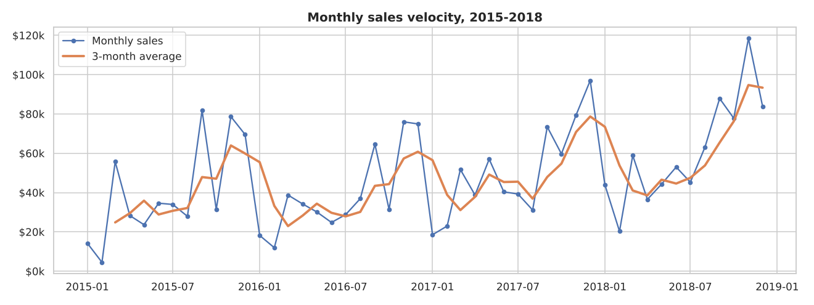
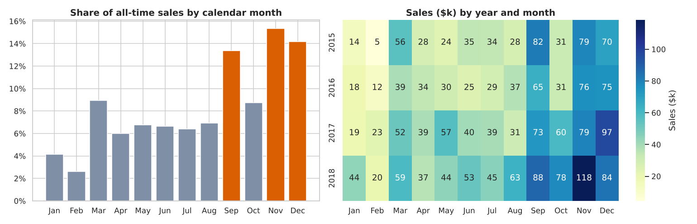
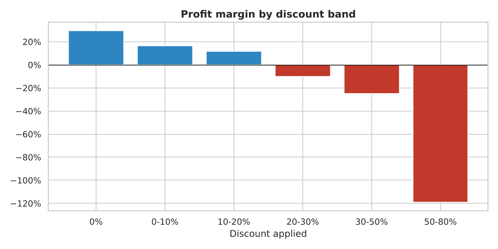
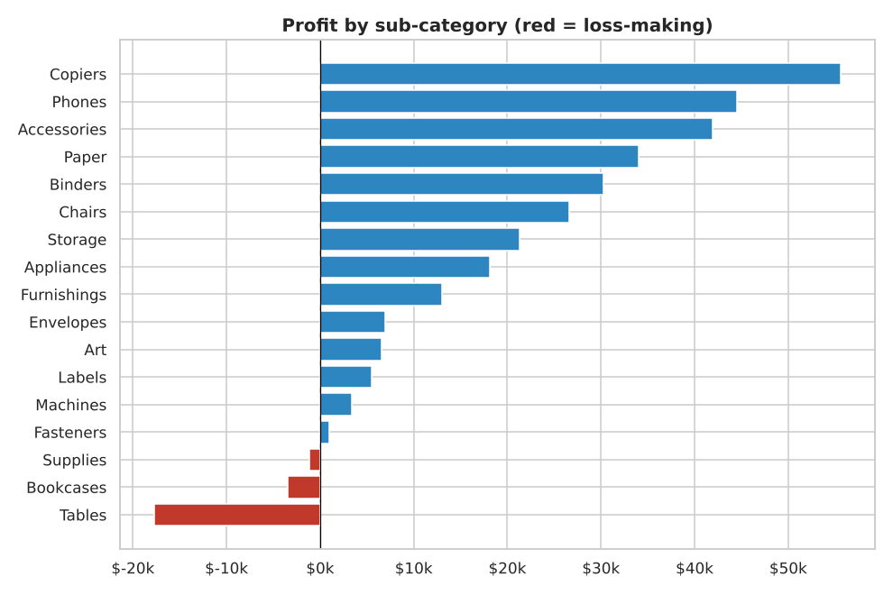
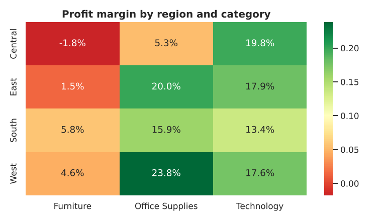

# Superstore Retail Sales: Exploratory Data Analysis

Exploratory analysis of four years of Superstore order data (2015-2018, ~10k order lines, 793 customers) to find what drives sales and profit. Built for **Task 1 of the Datheon Data Analytics & Power BI Internship**.



## Key findings

1. **Growth with better margins.** Sales rose from $484k (2015) to $733k (2018) and margin from 10.2% to 12.7%. Total: $2.30M sales, $286k profit.
2. **Q4-heavy demand.** September, November and December make up about 43% of annual sales; January and February only 6.7%.
3. **Furniture is the profit problem.** It is 32% of sales but only 6% of profit (2.5% margin). Tables (-8.6%) and Bookcases (-3.0%) lose money.
4. **Discounts above 20% destroy profit.** Margin is 29.5% with no discount and turns negative past 20%. The 1,393 lines discounted over 20% lose about $135k combined.
5. **Central region underperforms.** 7.9% margin vs 14.9% in the West, alongside much heavier discounting (24.0% average vs 10.9%).
6. **Loyal, evenly spread customers.** 98.5% of customers ordered more than once and the top 20% account for 48% of sales.

The full analysis, charts and recommendations are in [`superstore_eda.ipynb`](superstore_eda.ipynb).

## What the notebook covers

| Section | Content |
|---|---|
| Load and inspect | Raw load as text, shape, null counts |
| Missing-value profiling | Found two extra tables (People, Returns) appended to the CSV; split them and kept Returns for analysis |
| Cleaning | Type conversion, postal-code repair, date parsing, Year-Month, validation assertions |
| Analysis | KPIs, customer purchase volume, seasonality, category/region/segment, discount sensitivity, returns |
| Takeaways | 6 annotated business findings, recommendations, limitations |

## Data note

The source CSV contains three tables in one file: orders (9,994 rows), a People table and a Returns table. The 806 "null" rows seen on a naive load are the appended tables, not missing data. The notebook separates them explicitly.

## Run it locally

```bash
cd Task1_Superstore_EDA
pip install -r requirements.txt
jupyter notebook superstore_eda.ipynb
```

The dataset is expected at `data/superstore_sales.csv`.

## Tech

Python, pandas, NumPy, Matplotlib, Seaborn, Jupyter

## Charts

| | |
|---|---|
|  |  |
|  |  |
