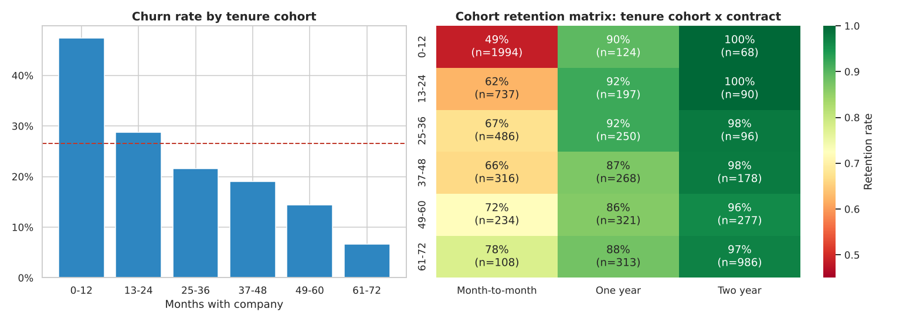
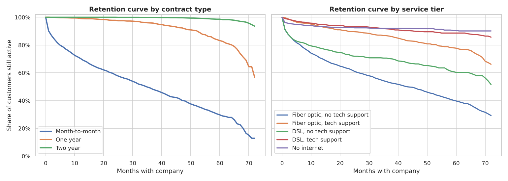
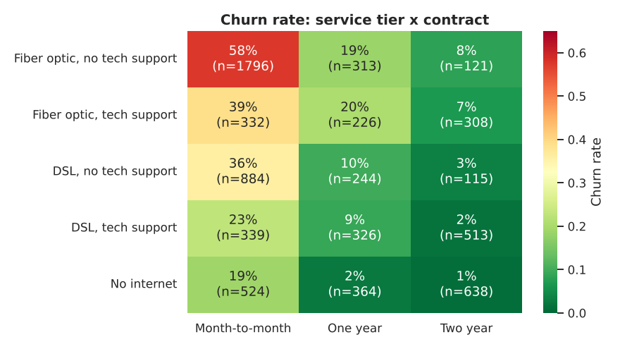
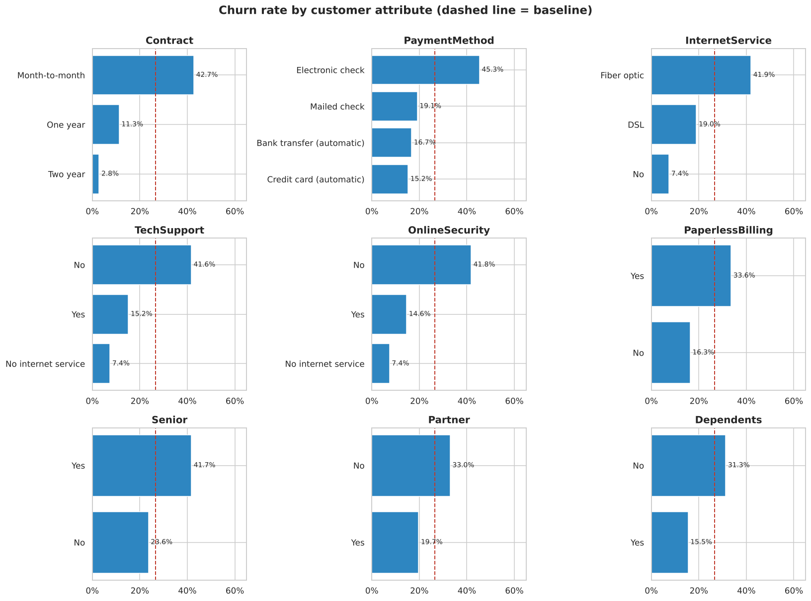
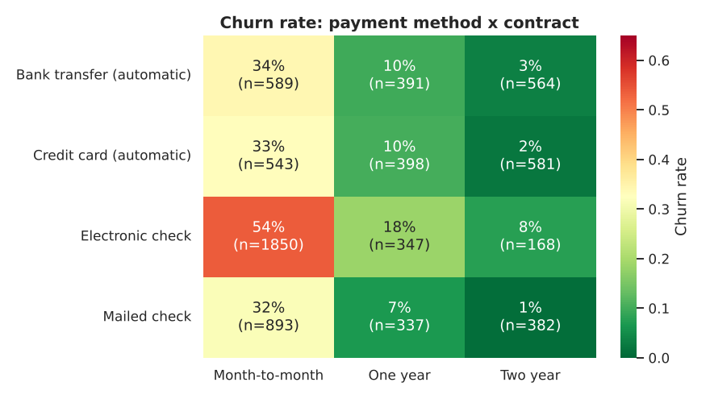

# Customer Cohort & Churn Analytics: IBM Telco Dataset

Analysis of 7,043 telecom customers to measure churn, build tenure-cohort retention matrices and retention curves, and identify the highest-risk customer segments. Built for **Task 3 of the Datheon Data Analytics & Power BI Internship**.



## Key findings

1. **Baseline churn is 26.5%** (1,869 of 7,043 customers), costing **$139k of $456k monthly revenue (30.5%)**. Churners pay more than loyal customers ($74.44 vs $61.27 per month).
2. **Contract type is the biggest lever.** Month-to-month churn is 42.7%, versus 11.3% (one-year) and 2.8% (two-year). Month-to-month customers are 55% of the base but 88.6% of churners.
3. **The first year is the danger zone.** 47.4% of customers in their first 12 months churn, and 55.5% of all churners left within a year.
4. **Fiber optic without tech support is high-risk.** Churn is 49.4%, versus 22.6% for fiber customers with tech support.
5. **Electronic check payers churn at 45.3%**, versus 15-19% for other payment methods.
6. **One segment drives most of the loss.** Month-to-month, fiber, no tech support: 25.5% of customers, 55.3% of churners, 63.4% of revenue lost.

## Retention recommendations

1. Move month-to-month customers onto longer contracts with an incentive, targeting months 3 to 10.
2. Build a first-year onboarding and check-in program.
3. Bundle tech support and online security for fiber customers (A/B test first).
4. Convert electronic check payers to automatic payment.
5. Investigate fiber service quality and pricing.
6. Offer simpler support options for senior customers.

Full analysis, charts, and limitations: [`telco_churn_analysis.ipynb`](telco_churn_analysis.ipynb).

## What the notebook covers

| Section | Content |
|---|---|
| Data quality | Found 11 blank `TotalCharges` values; all are brand-new customers (tenure 0), so they are kept with a value of 0 |
| Feature engineering | Tenure cohorts, monthly-charge bands, service tier (internet type + tech support) |
| Churn drivers | Churn rate by attribute and a ranking of attribute gaps |
| Cohort retention matrix | Tenure cohort x contract type |
| Retention curves | Kaplan-Meier style curves by contract and service tier |
| High-risk segments | Heatmaps, segment ranking, revenue at risk |

## Run it locally

```bash
cd Task3_Telco_Churn_Analytics
pip install -r requirements.txt
jupyter notebook telco_churn_analysis.ipynb
```

The dataset is expected at `data/telco_customer_churn.csv`.

## Tech

Python, pandas, NumPy, Matplotlib, Seaborn, Jupyter

## Charts

| | |
|---|---|
|  |  |
|  |  |
